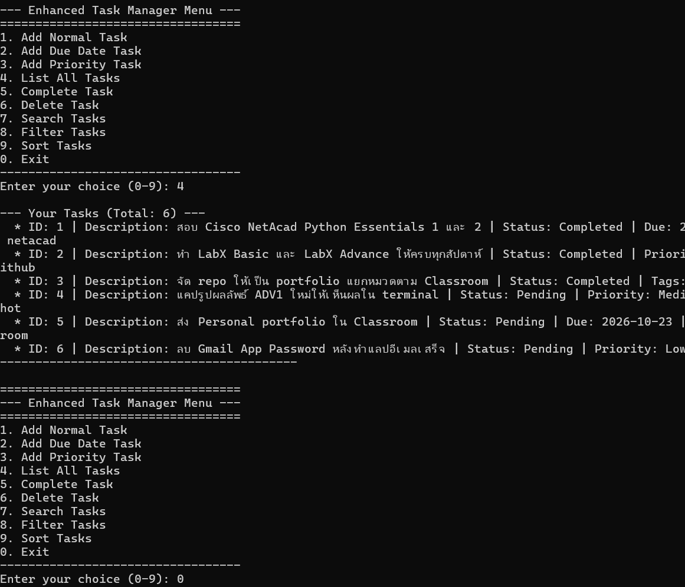
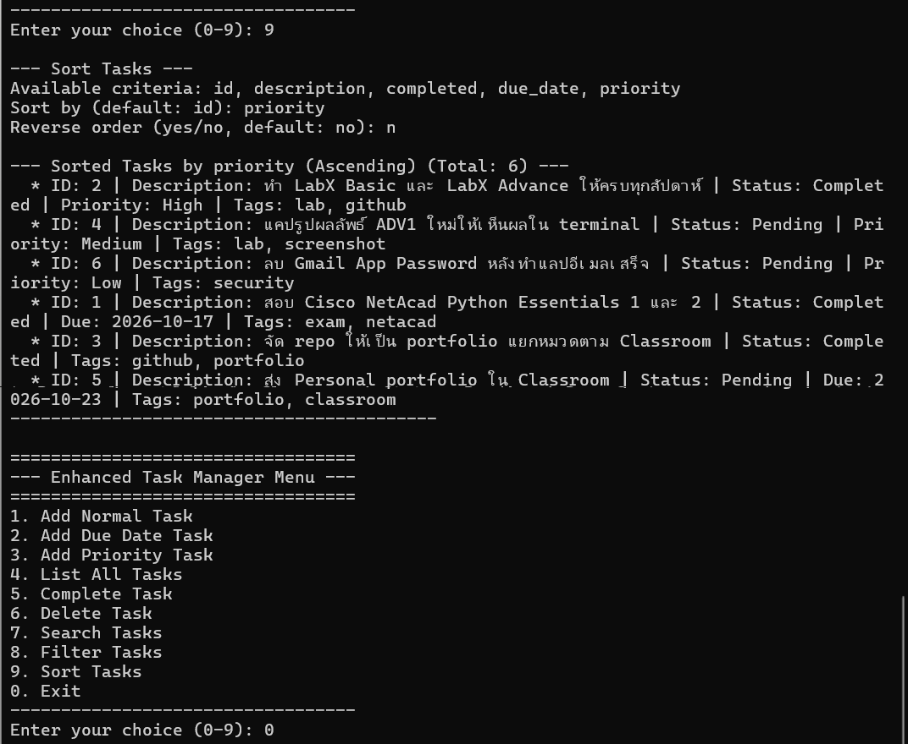

# Lab 12: Final Project Development – Enhanced Task Manager CLI

โปรแกรมจัดการงานแบบ Command Line ฉบับสมบูรณ์ พัฒนาต่อจาก Task Manager ที่ทำมาตลอดภาคเรียน

| รุ่น | งาน | แนวคิดหลัก |
| --- | --- | --- |
| 1 | [Class Activity 1](../../../Class-Activity/Activity1_CLI-Task-Manager/my-task-manager) | เขียนแบบ procedural ด้วย dict และฟังก์ชัน |
| 2 | [Class Activity 2](../../../Class-Activity/Activity2_OOP-Task-Manager/my-oop-task-manager) | ปรับเป็น OOP ด้วยคลาส `Task` และ `TaskManager` |
| 3 | [Class Activity 4](../../../Class-Activity/Activity4_Enhanced-Task-Manager/enhanced-task-manager-design) | ออกแบบคลาสลูก แยกชั้นข้อมูล และเริ่มทำ search / filter / sort |
| 4 | **Lab 12 (โฟลเดอร์นี้)** | รวมทุกฟีเจอร์ เพิ่มการตรวจข้อมูลนำเข้า และมี unit test |

รายละเอียดการออกแบบ ปัญหาทางเทคนิค และสิ่งที่ได้เรียนรู้ อยู่ใน [PLAN.md](PLAN.md)

## เมนู

```
1. Add Normal Task        6. Delete Task
2. Add Due Date Task      7. Search Tasks
3. Add Priority Task      8. Filter Tasks
4. List All Tasks         9. Sort Tasks
5. Complete Task          0. Exit
```

## วิธีรัน

```powershell
python main.py                       # รันโปรแกรม
python -m unittest discover tests    # รัน unit test
```

ใช้เฉพาะ library มาตรฐานของ Python ไม่ต้องติดตั้งเพิ่ม ข้อมูลตัวอย่างใน `data/tasks.json` เป็นงานที่ต้องทำจริงของรายวิชานี้

## ผลลัพธ์



