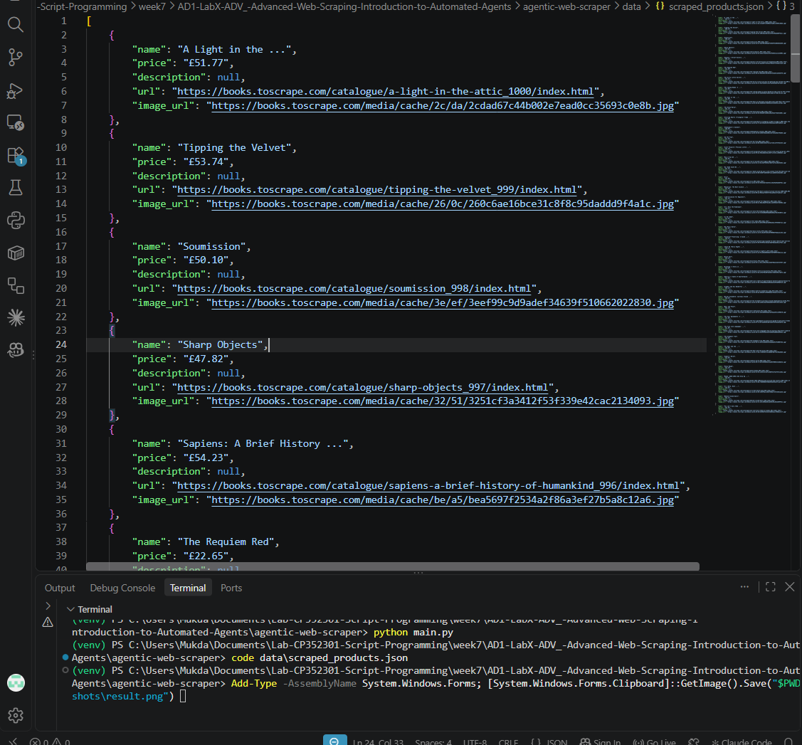

# Week 7 – AD1 LabX ADV: Advanced Web Scraping & Introduction to Automated Agents

Scraper แบบ "agentic" ที่ใช้ **Selenium** ควบคุมเบราว์เซอร์ Chrome (headless) และทำงานตามคำสั่งในไฟล์ config (`configs/example_site_config.json`) ไม่ต้องแก้โค้ดเมื่อเปลี่ยนเว็บเป้าหมาย

- เว็บเป้าหมาย: https://books.toscrape.com (เว็บที่ทำไว้ให้ฝึก scraping โดยเฉพาะ)
- ดึงข้อมูล 2 หน้า (`max_pages: 2`) ได้หนังสือ 40 เล่ม: ชื่อ ราคา ลิงก์ และรูปภาพ
- บันทึกผลเป็น `data/scraped_products.json`

## วิธีรัน (Windows PowerShell, ต้องมี Google Chrome ในเครื่อง)

```powershell
python -m venv venv
.\venv\Scripts\Activate.ps1
pip install -r requirements.txt
python test_setup.py      # ทดสอบ Selenium (ต้องเห็น Title: All products | Books to Scrape - Sandbox)
python main.py            # รัน scraper
```

## โครงสร้างโปรเจกต์

```
agentic-web-scraper/
├── src/
│   ├── __init__.py
│   ├── scraper_agent.py      # ตรรกะหลักของ agent (อ่าน config, ควบคุม Selenium, เปลี่ยนหน้า)
│   ├── config_parser.py      # อ่านและตรวจสอบไฟล์ config
│   ├── data_models.py        # dataclass Product
│   ├── utils.py              # ฟังก์ชันช่วย (บันทึก JSON ฯลฯ)
│   └── driver_manager.py     # ตั้งค่า Selenium WebDriver
├── configs/
│   └── example_site_config.json
├── data/
│   └── scraped_products.json # ไฟล์ที่ได้หลังรัน
├── screenshots/
│   └── result.png
├── main.py
├── test_setup.py
└── requirements.txt
```

## ผลลัพธ์


