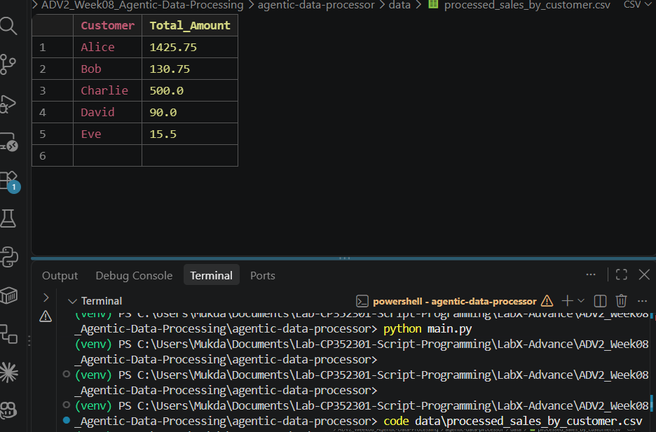
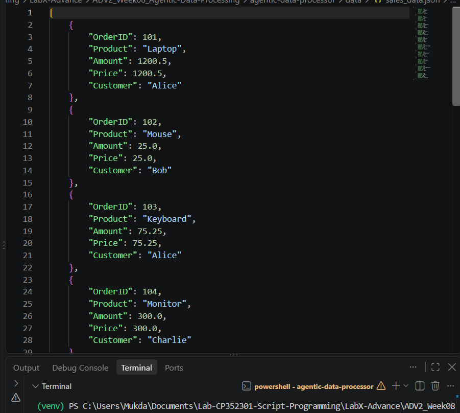
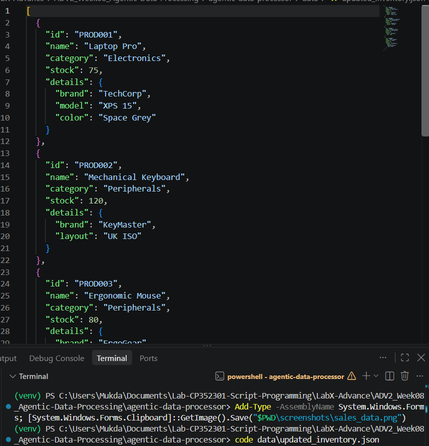

# LabX ADV (Week 8): Agentic Data Processing – Advanced CSV & JSON Workflows

Data Agent ที่ทำงานตามลำดับ task ในไฟล์ config (`configs/data_pipeline_config.json`) ไม่ต้องแก้โค้ดเมื่อเปลี่ยนขั้นตอน ใช้แค่โมดูลมาตรฐานของ Python (`csv`, `json`, `logging`)

| ลำดับ | Task | ผลลัพธ์ |
| --- | --- | --- |
| 1 | โหลด `data/input_sales.csv` | – |
| 2 | รวมยอด `Amount` ตาม `Customer` | `data/processed_sales_by_customer.csv` |
| 3 | แปลงข้อมูลขายจาก CSV เป็น JSON (แปลงตัวเลขเป็น int/float ให้อัตโนมัติ) | `data/sales_data.json` |
| 4 | โหลด `data/input_inventory.json` แก้ stock / layout / dpi เพิ่มสี และเพิ่มสินค้า PROD004 Smart Speaker | `data/updated_inventory.json` |
| 5 | Query ค่า `0.details.brand` | แสดงใน log |
| 6 | บันทึก audit log ของทุก task | `reports/audit_report_*.json` |

## วิธีรัน

```powershell
python -m venv venv
.\venv\Scripts\Activate.ps1
python main.py
```

ไม่ต้อง `pip install` อะไรเพิ่ม

## สิ่งที่แก้จากโค้ดต้นฉบับ

- `src/json_tasks.py`: ลบ `from turtle import update` กับ `from os import path` ที่ไม่ได้ใช้ออก (`turtle` เป็นโมดูลวาดรูปที่ต้องใช้ tkinter ถ้าเครื่องไม่มี tkinter โปรแกรมจะ error ทั้งที่ไม่ได้ใช้)

## ผลลัพธ์

### processed_sales_by_customer.csv


### sales_data.json


### updated_inventory.json

