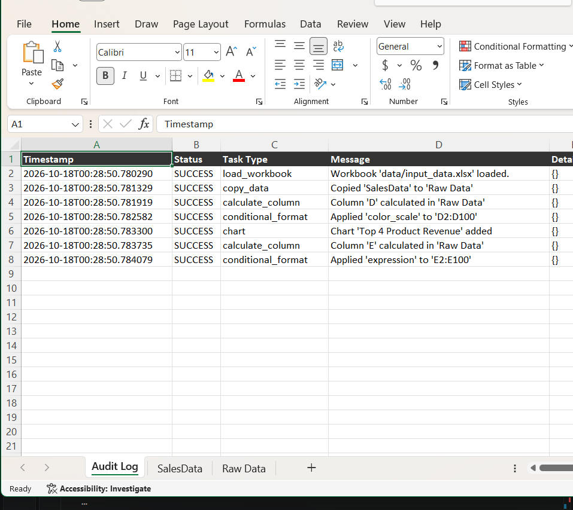
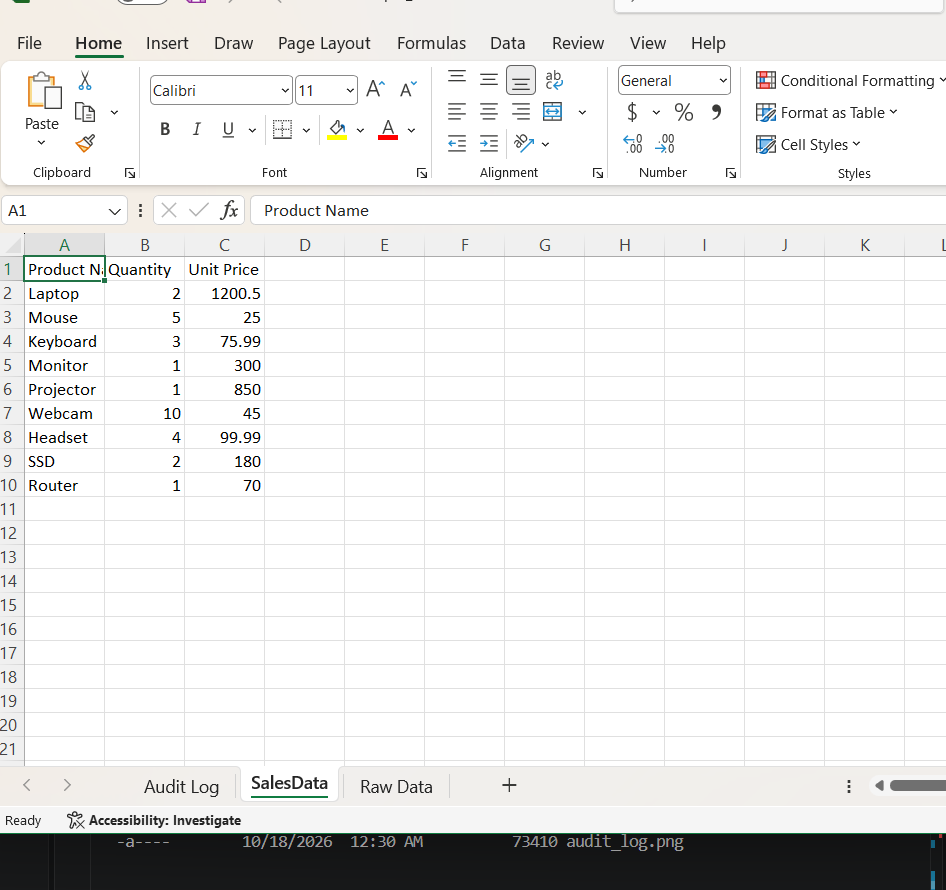
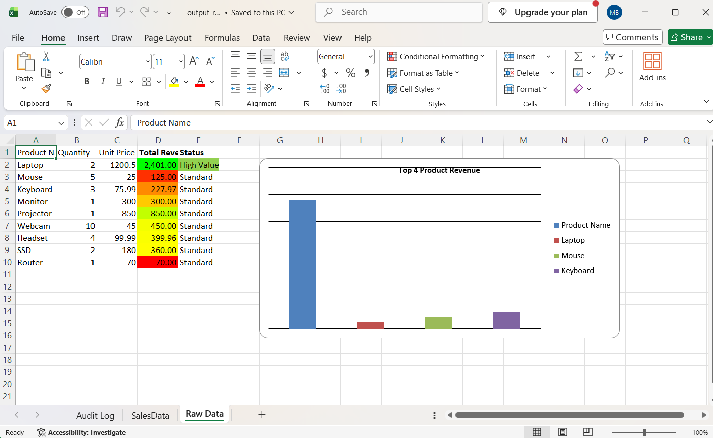

# LabX ADV (Week 10): Advanced Spreadsheet Automation & Agentic Workflows

Spreadsheet Agent ที่ใช้ `openpyxl` ทำงานกับไฟล์ Excel ตามลำดับ task ในไฟล์ config (`configs/example_spreadsheet_config.json`)

| ลำดับ | Task | รายละเอียด |
| --- | --- | --- |
| 1 | `copy_data` | คัดลอกชีต `SalesData` ไปเป็นชีตใหม่ `Raw Data` |
| 2 | `calculate_column` | เพิ่มคอลัมน์ D `Total Revenue` = Quantity × Unit Price (สูตร `=B2*C2`) |
| 3 | `conditional_format` | ไล่สีคอลัมน์ D แดง → เหลือง → เขียว ตามยอดรายได้ |
| 4 | `chart` | สร้างกราฟแท่ง "Top 4 Product Revenue" ที่เซลล์ G2 |
| 5 | `calculate_column` | เพิ่มคอลัมน์ E `Status` = "High Value" ถ้ารายได้เกิน 1,000 ไม่งั้นเป็น "Standard" |
| 6 | `conditional_format` | ระบายสีเขียวแถวที่เป็น "High Value" |
| – | Audit Log | สร้างชีต `Audit Log` บันทึกผลของทุก task ไว้หน้าแรกของไฟล์ |

ผลลัพธ์บันทึกเป็น `data/output_report.xlsx` มี 3 ชีต: **Audit Log**, **SalesData**, **Raw Data**

## วิธีรัน (ต้องรันในโฟลเดอร์นี้ เพราะ config ใช้ path แบบ `data/...`)

```powershell
python -m venv venv
.\venv\Scripts\Activate.ps1
pip install -r requirements.txt
python main.py
```

ถ้าไฟล์ `data/input_data.xlsx` หาย สร้างใหม่ได้ด้วย `python create_dummy_data.py`

## ผลลัพธ์

### ชีต Audit Log


### ชีต SalesData


### ชีต Raw Data

