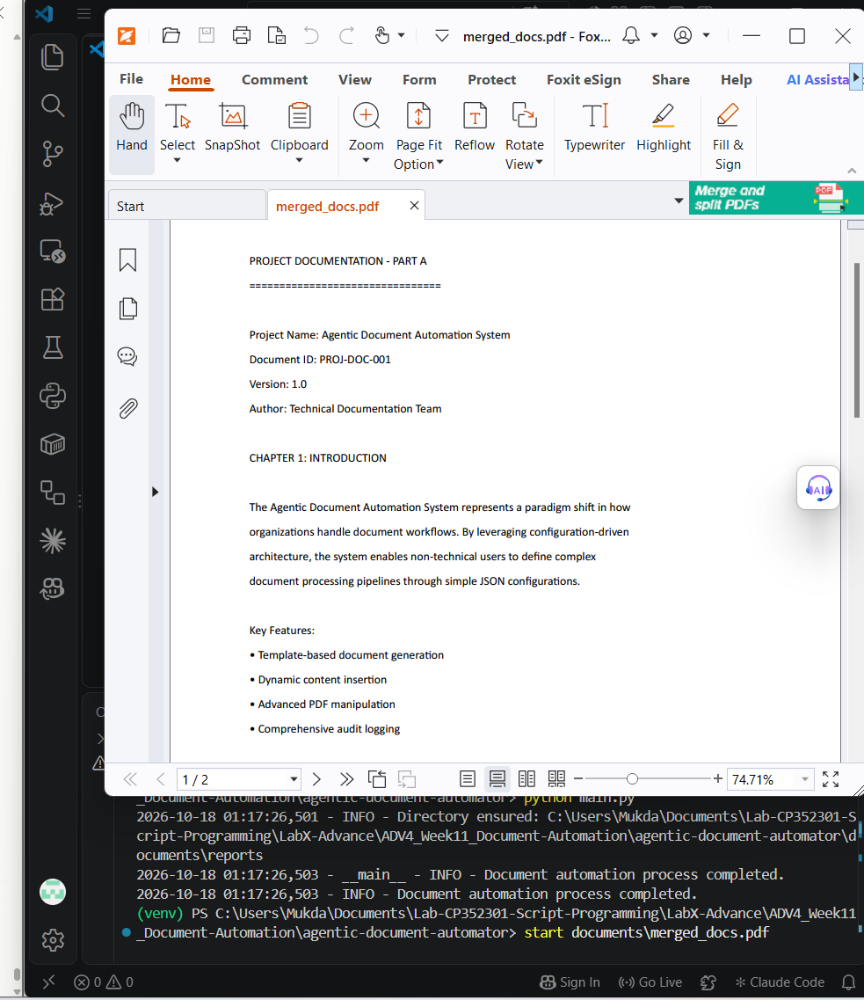
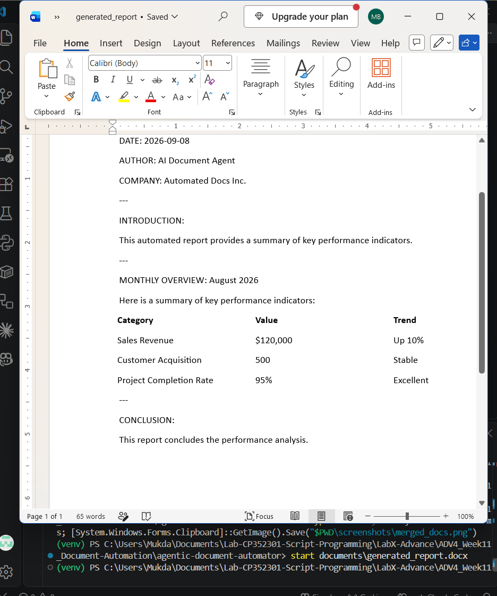
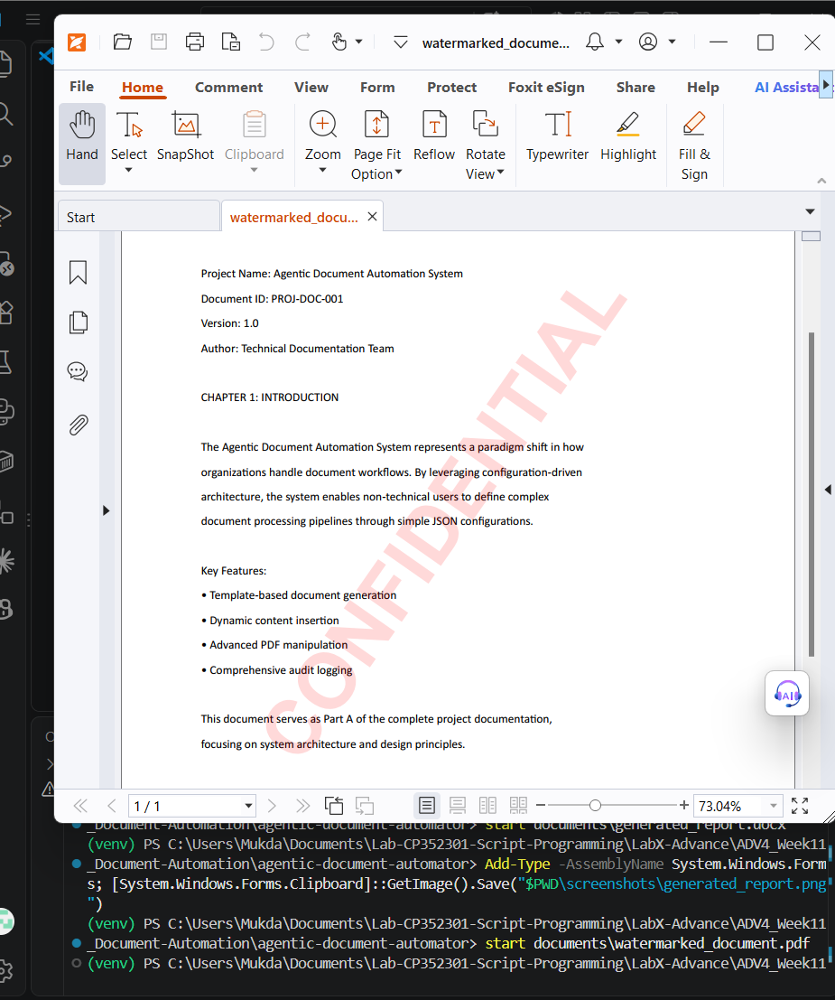

# LabX ADV (Week 11): Project Planning & Design – Agentic Document Automation

Document Agent ที่ใช้ `python-docx`, `PyPDF2` และ `reportlab` ทำงานกับเอกสาร Word/PDF ตามลำดับ task ในไฟล์ config (`configs/document_automation_config.json`)

| ลำดับ | Task | ผลลัพธ์ |
| --- | --- | --- |
| 1 | สร้างรายงาน Word จาก template แทนค่า `{{...}}` และใส่ตาราง KPI | `documents/generated_report.docx` |
| 2 | ใส่ลายน้ำ "CONFIDENTIAL" สีแดงโปร่งแสง เอียง 55° ลงใน `source_document.pdf` | `documents/watermarked_document.pdf` |
| 3 | รวม `dummy_doc1.pdf` + `dummy_doc2.pdf` | `documents/merged_docs.pdf` |
| 4 | ดึงข้อความจากรายงาน Word | `documents/extracted_word_text.txt` |
| 5 | ดึงข้อความจาก PDF ต้นฉบับ | `documents/extracted_pdf_text.txt` |
| – | บันทึก audit log ของทุก task | `documents/reports/audit_report_*.json` |

## วิธีรัน

```powershell
python -m venv venv
.\venv\Scripts\Activate.ps1
pip install -r requirements.txt
python main.py
```

## สิ่งที่แก้จากโค้ดต้นฉบับ

- `requirements.txt` ของต้นฉบับว่างเปล่า เพิ่ม `PyPDF2`, `reportlab`, `python-docx`
- `main.py`: เพิ่ม `output_path` ในรายการ path ที่แปลงเป็น absolute ไม่งั้นไฟล์ `generated_report.docx` จะไปถูกสร้างตามโฟลเดอร์ที่สั่งรัน ไม่ใช่ในโฟลเดอร์ `documents` ของโปรเจกต์
- `src/document_agent.py`: ครอบชื่อ placeholder ด้วย `{{ }}` ให้ตรงกับ template เดิมแทนที่แค่ชื่อ ทำให้รายงานเหลือวงเล็บปีกกา เช่น `{{Monthly Performance Summary}}`
- `src/word_tasks.py`: ใส่ตารางตรงตำแหน่ง `{{TABLE_PLACEHOLDER}}` เดิมตารางไปต่อท้ายเอกสาร หลังหัวข้อ CONCLUSION

## ผลลัพธ์

### merged_docs.pdf


### generated_report.docx


### watermarked_document.pdf

