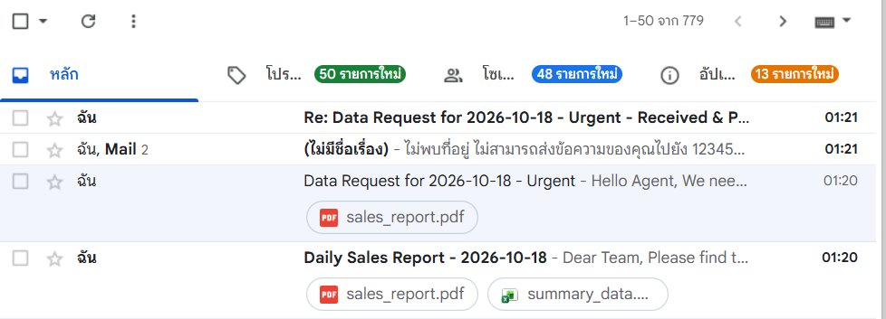

# LabX ADV (Week 12): Agentic Communication Workflows – Advanced Email & SMS

Communication Agent ที่ทำงานตามลำดับ task ในไฟล์ config (`configs/comm_pipeline_config.json`) ส่งอีเมล ตรวจ inbox และตอบกลับอัตโนมัติตามกฎ (rule-based) โดยใช้ `smtplib` / `imaplib` และเก็บรหัสผ่านไว้ใน `.env`

| ลำดับ | Task | สิ่งที่เกิดขึ้น |
| --- | --- | --- |
| 1 | `send_email` | ส่งอีเมล "Daily Sales Report - วันที่" พร้อมไฟล์แนบ `sales_report.pdf` และ `summary_data.xlsx` (ใส่ยอดขายจาก context ด้วย template) |
| 2 | `send_email` | ส่งอีเมล "Data Request for วันที่ - Urgent" หาตัวเอง เพื่อจำลองคำขอที่เข้ามา |
| 3 | `process_inbox` | ค้นหาอีเมลที่ยังไม่อ่านและมีคำว่า "Data Request" แล้วใช้กฎ: **ถ้า** หัวเรื่องมี "Urgent" และมีไฟล์แนบ → ส่ง SMS แจ้งเตือน, **ถ้า** เนื้อหามี "new data processing" → ตอบกลับอัตโนมัติ "Re: ... - Received & Processing" |
| – | Audit log | บันทึกผลทุก task ใน `reports/audit_report_comm_*.json` |

## วิธีรัน

```powershell
python -m venv venv
.\venv\Scripts\Activate.ps1
pip install -r requirements.txt
copy .env.example .env      # แล้วกรอก SENDER_EMAIL กับ SENDER_APP_PASSWORD (Gmail App Password)
python main.py
```

## สิ่งที่แก้จากโค้ดต้นฉบับ

- `configs/comm_pipeline_config.json`: เปลี่ยนอีเมลตัวอย่าง (`your_gmail_address@gmail.com`) เป็น `{sender_email}` ให้ดึงจาก `.env` อัตโนมัติ ไม่ต้องแก้อีเมลใน config และใส่ชื่อ-รหัสนักศึกษาท้ายอีเมลรายงาน
- `src/communication_agent.py`: เพิ่ม `sender_email` ลงใน context และรอ 10 วินาทีก่อนตรวจ inbox ให้อีเมลที่เพิ่งส่งเข้ามาทัน
- `src/email_tasks.py`: ครอบค่าที่ใช้ค้นหา IMAP ด้วย `"..."` เพราะหัวเรื่อง "Data Request" มีช่องว่าง ถ้าไม่ครอบ Gmail จะค้นหาไม่ได้
- เพิ่มไฟล์แนบตัวอย่าง `data/reports/sales_report.pdf` และ `summary_data.xlsx` ที่ต้นฉบับไม่มี
- เพิ่ม `requirements.txt` (`python-dotenv`) และ `.env.example`

SMS ส่งผ่าน Email-to-SMS Gateway ของเครือข่ายในสหรัฐฯ (`@txt.att.net`) ใช้กับเบอร์ไทยไม่ได้ จึงจะได้อีเมลตีกลับ "ไม่พบที่อยู่"

## ผลลัพธ์


