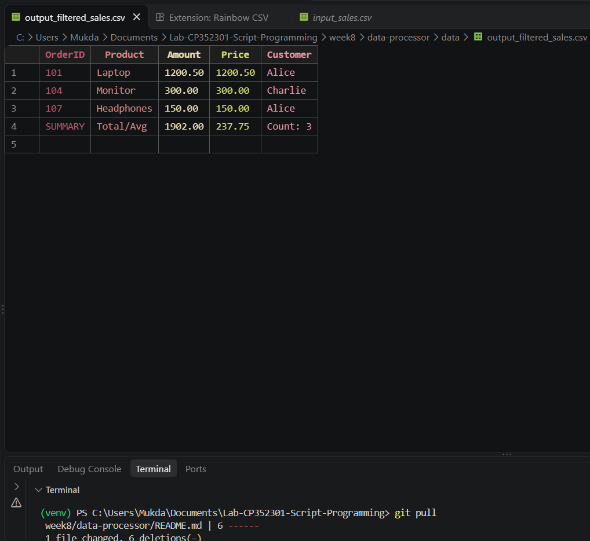
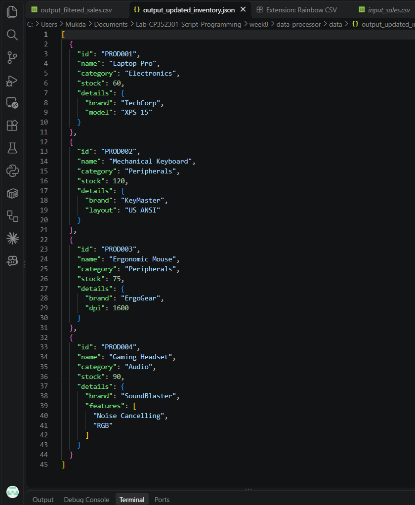

# Week 8 – LabX Basic: Automating with CSV and JSON Data

อ่าน ประมวลผล และเขียนไฟล์ CSV / JSON ด้วยโมดูลมาตรฐานของ Python (`csv`, `json`, `logging`)

- **CSV:** อ่าน `data/input_sales.csv` แล้วกรองเฉพาะรายการที่ Amount ≥ 100 พร้อมเพิ่มแถวสรุป (ยอดรวม / ราคาเฉลี่ย / จำนวน) จากนั้นบันทึกเป็น `data/output_filtered_sales.csv`
- **JSON:** อ่าน `data/input_inventory.json` อัปเดต stock ของ PROD001 → 60 และ PROD003 → 75 และเพิ่มสินค้าใหม่ PROD004 (Gaming Headset) จากนั้นบันทึกเป็น `data/output_updated_inventory.json`

## วิธีรัน

```powershell
python -m venv venv
venv\Scripts\Activate.ps1
python main.py
```

ไม่ต้องติดตั้งไลบรารีเพิ่ม ใช้แค่โมดูลที่มากับ Python

## โครงสร้างโปรเจกต์

```
data-processor/
├── src/
│   ├── __init__.py
│   ├── csv_handler.py     # อ่าน/เขียน/ประมวลผล CSV
│   ├── json_handler.py    # อ่าน/เขียน/แก้ไข JSON
│   └── utils.py           # logging + สร้างโฟลเดอร์
├── data/
│   ├── input_sales.csv
│   ├── input_inventory.json
│   ├── output_filtered_sales.csv       # ไฟล์ที่ได้หลังรัน
│   └── output_updated_inventory.json   # ไฟล์ที่ได้หลังรัน
├── screenshots/
│   ├── output_filtered_sales.png
│   └── output_updated_inventory.png
├── main.py
└── README.md
```

## ผลลัพธ์

### output_filtered_sales.csv


### output_updated_inventory.json

