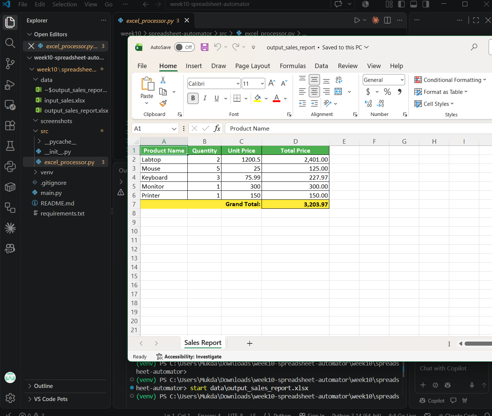

# Week 10 – LabX Basic: Automating Spreadsheets (Excel)

อ่านข้อมูลยอดขายจาก `data/input_sales.xlsx` ด้วย `openpyxl` แล้วคำนวณ Total Price ของแต่ละรายการและ Grand Total จากนั้นเขียนรายงานพร้อมจัดรูปแบบ (หัวตารางสีเขียว แถวรวมสีเหลือง เส้นขอบ และปรับความกว้างคอลัมน์) ลงไฟล์ `data/output_sales_report.xlsx`

## วิธีรัน (ต้องรันในโฟลเดอร์ `spreadsheet-automator`)

```powershell
python -m venv venv
venv\Scripts\Activate.ps1
pip install -r requirements.txt
python main.py
```

## โครงสร้างโปรเจกต์

```
spreadsheet-automator/
├── src/
│   ├── __init__.py
│   └── excel_processor.py   # อ่าน/คำนวณ/เขียน Excel
├── data/
│   ├── input_sales.xlsx
│   └── output_sales_report.xlsx   # ไฟล์ที่ได้หลังรัน
├── screenshots/
│   └── output_sales_report.png
├── main.py
├── requirements.txt
└── README.md
```

## ผลลัพธ์


