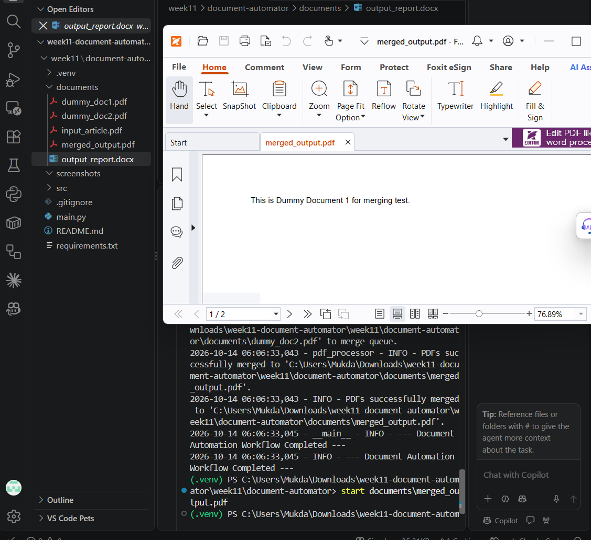
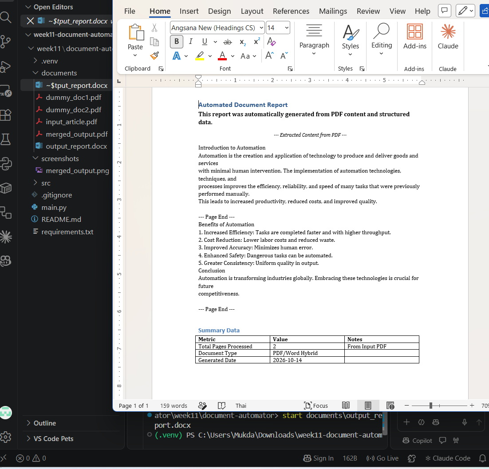

# Week 11 – LabX Basic: Automating PDFs & Word Documents

ใช้ `PyPDF2` กับ `python-docx` ทำงานเอกสารอัตโนมัติ 2 งาน

- **Task 1:** ดึงข้อความจาก `documents/input_article.pdf` แล้วสร้างรายงาน Word `documents/output_report.docx` ที่มีหัวข้อ ข้อความจัดรูปแบบ (ตัวหนา/ตัวเอียง) เนื้อหาที่ดึงจาก PDF และตาราง Summary Data
- **Task 2:** รวม `dummy_doc1.pdf` กับ `dummy_doc2.pdf` เป็นไฟล์เดียว `documents/merged_output.pdf`

## วิธีรัน

```powershell
python -m venv .venv
.\.venv\Scripts\Activate.ps1
pip install -r requirements.txt
python main.py
```

## โครงสร้างโปรเจกต์

```
document-automator/
├── src/
│   ├── __init__.py
│   ├── pdf_processor.py     # ดึงข้อความ / รวม / แยก PDF (PyPDF2)
│   ├── word_processor.py    # สร้างและเพิ่มเนื้อหาในไฟล์ Word (python-docx)
│   └── utils.py             # logging + สร้างโฟลเดอร์
├── documents/
│   ├── input_article.pdf
│   ├── dummy_doc1.pdf
│   ├── dummy_doc2.pdf
│   ├── output_report.docx   # ไฟล์ที่ได้หลังรัน
│   └── merged_output.pdf    # ไฟล์ที่ได้หลังรัน
├── screenshots/
│   ├── merged_output.png
│   └── output_report.png
├── main.py
├── requirements.txt
└── README.md
```

## สิ่งที่แก้จากโค้ดในเอกสาร

- `pdf_processor.py`, `word_processor.py`: เปลี่ยน `from .utils import ...` เป็น `from utils import ...` เพราะ `main.py` เพิ่มโฟลเดอร์ `src` เข้า path แล้ว import ไฟล์ตรง ๆ ถ้าใช้ `.utils` จะ error `attempted relative import with no known parent package`
- `pdf_processor.py`: เพิ่มการ import `ensure_directory_exists` และแก้ `range(0_int, ...)` เป็น `range(0, ...)` ในฟังก์ชัน `split_pdf`
- `main.py`: ย้าย `import datetime` ขึ้นไปไว้ด้านบนไฟล์

## ผลลัพธ์

### merged_output.pdf


### output_report.docx

