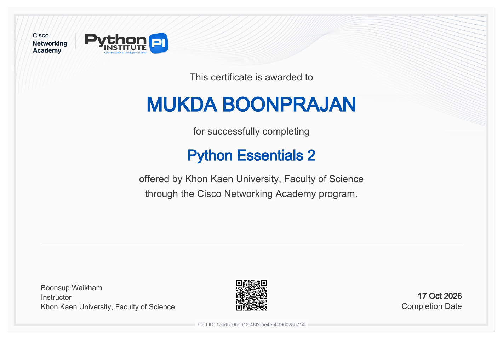

# Lab CP352301 Script Programming

มุกดา บุญประจันทร์ 673380598-1

รวมงานทั้งหมดของรายวิชา Script Programming

## โครงสร้างไฟล์ (File Structure)

repository นี้จัดตามโครงสร้างที่รายวิชากำหนด แต่ตั้งชื่อโฟลเดอร์เป็นภาษาอังกฤษไม่มีช่องว่าง และระบุสัปดาห์กับหัวข้อไว้ในชื่อ เพื่อให้ใช้กับคำสั่ง Git และ terminal ได้สะดวก โดยเทียบกับชื่อที่กำหนดได้ดังนี้

| โครงสร้างที่กำหนด | โฟลเดอร์ใน repository นี้ | เนื้อหา |
| --- | --- | --- |
| Lab | [`Lab/`](Lab) | Lab ประจำสัปดาห์ Week 1–6 และ Week 12 |
| Lab X Basic | [`LabX-Basic/`](LabX-Basic) | Lab Basic 5 งาน |
| Lab 1 Basic – Lab 5 Basic | `Week07_…`, `Week08_…`, `Week10_…`, `Week11_…`, `Week12_…` | Lab 1 = Week 7, Lab 2 = Week 8, Lab 3 = Week 10, Lab 4 = Week 11, Lab 5 = Week 12 |
| Lab X Advance | [`LabX-Advance/`](LabX-Advance) | Lab Advance 5 งาน |
| Lab 1 Advance – Lab 5 Advance | `ADV1_…` ถึง `ADV5_…` | ADV1 = Week 7, ADV2 = Week 8, ADV3 = Week 10, ADV4 = Week 11, ADV5 = Week 12 |
| mini Project | [`Mini-Project/`](Mini-Project) | ไฟล์ `README.md` พร้อมลิงก์ไปยัง repository ของ Mini Project |
| Final Project | [`Final-Project/`](Final-Project) | ไฟล์ `README.md` พร้อมลิงก์ไปยัง repository ของ Final Project |
| certificate | [`Certificates/`](Certificates) | ภาพใบรับรอง (PNG) และไฟล์ PDF จาก Cisco NetAcad |
| (เพิ่มเติม) | [`Class-Activity/`](Class-Activity) | Class Activity 1–4 |
| (เพิ่มเติม) | [`Personal_Reflection.md`](Personal_Reflection.md) | สรุปการเรียนรู้และความคิดเห็นต่อรายวิชา |

ภายในแต่ละงานมีโฟลเดอร์ `screenshots/` เก็บภาพผลลัพธ์ และ `README.md` อธิบายวิธีรันและผลลัพธ์ของงานนั้น

## Lab ประจำสัปดาห์
| Week | หัวข้อ |
| --- | --- |
| [Week 1](Lab/Week1) | Introduction to Python & Basic Syntax |
| [Week 2](Lab/Week2) | Control Flow: Conditionals |
| [Week 3](Lab/Week3) | Control Flow: Loops |
| [Week 4](Lab/Week4) | Data Structures: Lists & Tuples |
| [Week 5](Lab/Week5) | Data Structures: Dictionaries & Sets |
| [Week 6](Lab/Week6) | Functions & Modules |
| [Week 12](Lab/Week12/final-task-manager) | Final Project Development: Enhanced Task Manager |

ต้นฉบับ Week 1–3: https://github.com/mukda9mm/673380598-1_sec2_script_programming

## LabX Basic
| งาน | โฟลเดอร์ |
| --- | --- |
| Lab 1 Basic (Week 7) – Introduction to Web Scraping | [Week07_Web-Scraping](LabX-Basic/Week07_Web-Scraping/web-scraping-intro) |
| Lab 2 Basic (Week 8) – Automating with CSV and JSON Data | [Week08_CSV-JSON](LabX-Basic/Week08_CSV-JSON/data-processor) |
| Lab 3 Basic (Week 10) – Automating Spreadsheets | [Week10_Spreadsheet](LabX-Basic/Week10_Spreadsheet/spreadsheet-automator) |
| Lab 4 Basic (Week 11) – Automating PDFs & Word Documents | [Week11_PDF-Word](LabX-Basic/Week11_PDF-Word/document-automator) |
| Lab 5 Basic (Week 12) – Automating Communications (Email & SMS) | [Week12_Email-SMS](LabX-Basic/Week12_Email-SMS/email-sms-automator) |

## LabX Advance
| งาน | โฟลเดอร์ |
| --- | --- |
| Lab 1 Advance (Week 7) – Advanced Web Scraping & Introduction to Automated Agents | [ADV1_Web-Scraping-Agents](LabX-Advance/ADV1_Web-Scraping-Agents/agentic-web-scraper) |
| Lab 2 Advance (Week 8) – Agentic Data Processing (Advanced CSV & JSON Workflows) | [ADV2_Week08_Agentic-Data-Processing](LabX-Advance/ADV2_Week08_Agentic-Data-Processing/agentic-data-processor) |
| Lab 3 Advance (Week 10) – Advanced Spreadsheet Automation & Agentic Workflows | [ADV3_Week10_Spreadsheet-Automation](LabX-Advance/ADV3_Week10_Spreadsheet-Automation/advanced-spreadsheet-automator) |
| Lab 4 Advance (Week 11) – Project Planning & Design (Agentic Document Automation) | [ADV4_Week11_Document-Automation](LabX-Advance/ADV4_Week11_Document-Automation/agentic-document-automator) |
| Lab 5 Advance (Week 12) – Agentic Communication Workflows (Advanced Email & SMS) | [ADV5_Week12_Agentic-Communication](LabX-Advance/ADV5_Week12_Agentic-Communication/agentic-comm-automator) |

## Class Activity
| งาน | โฟลเดอร์ |
| --- | --- |
| Class Activity 1 – Building a Simple CLI Application (Task Manager) | [Activity1_CLI-Task-Manager](Class-Activity/Activity1_CLI-Task-Manager/my-task-manager) |
| Class Activity 2 – Object-Oriented Programming (OOP Task Manager) | [Activity2_OOP-Task-Manager](Class-Activity/Activity2_OOP-Task-Manager/my-oop-task-manager) |
| Class Activity 3 – Interacting with Web APIs (Fetching JSON Data) | [Activity3_Web-API-Fetcher](Class-Activity/Activity3_Web-API-Fetcher/my-api-fetcher) |
| Class Activity 4 – Project Planning & Design (Enhanced Task Manager) | [Activity4_Enhanced-Task-Manager](Class-Activity/Activity4_Enhanced-Task-Manager/enhanced-task-manager-design) |

## Projects
| งาน | รายละเอียด |
| --- | --- |
| Mini Project – ระบบแจ้งเตือนเครื่องซักผ้าร้านหยอดเหรียญ | [Mini-Project](Mini-Project) → https://github.com/preemphatp/Mini_Project |
| Final Project – Virtual Pet Companion | [Final-Project](Final-Project) → https://github.com/144P75/script_project |

## Personal Reflection
[Personal_Reflection.md](Personal_Reflection.md) สรุปสิ่งที่ได้เรียนรู้ การสะท้อนคิด และความคิดเห็นต่อรายวิชา

## Certificates
| ใบรับรอง | รูปภาพ | PDF |
| --- | --- | --- |
| Cisco NetAcad: Python Essentials 1 | [PNG](Certificates/Python_Essentials_1_certificate.png) | [PDF](Certificates/Python_Essentials_1_certificate.pdf) |
| Cisco NetAcad: Python Essentials 2 | [PNG](Certificates/Python_Essentials_2_certificate.png) | [PDF](Certificates/Python_Essentials_2_certificate.pdf) |

 
